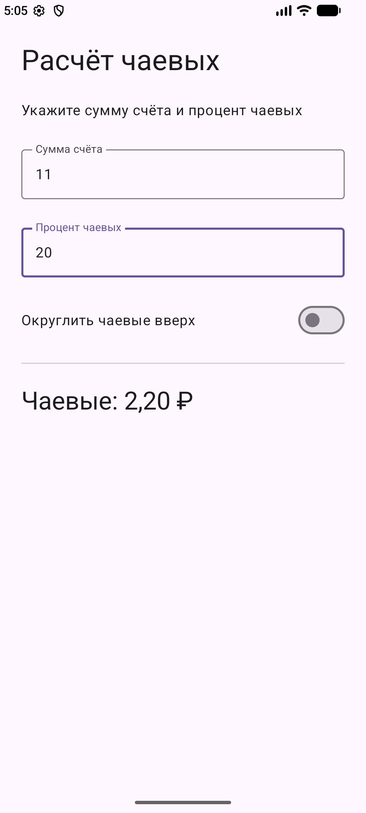
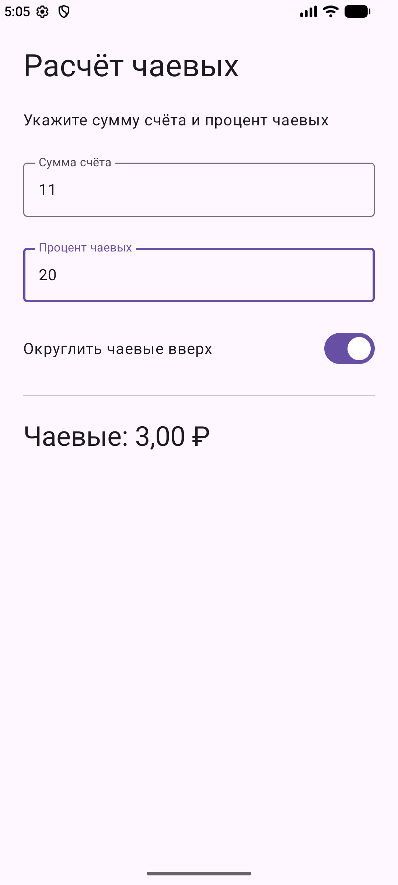
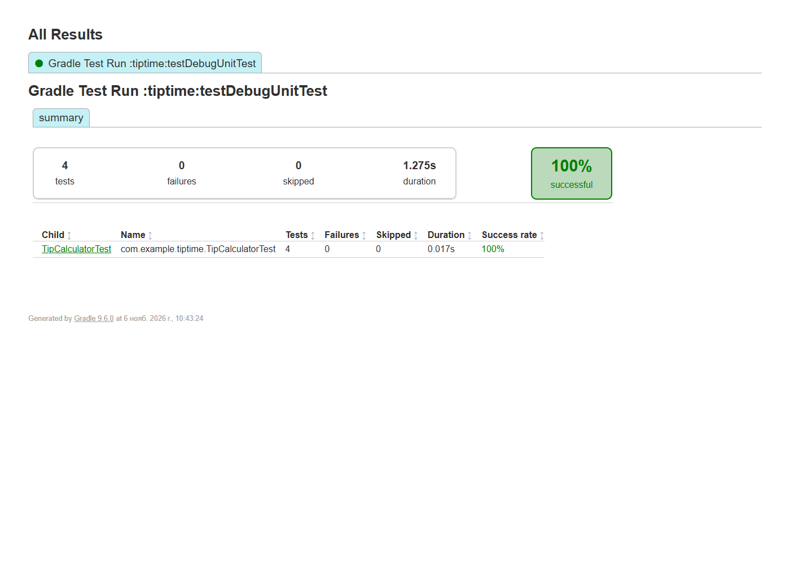
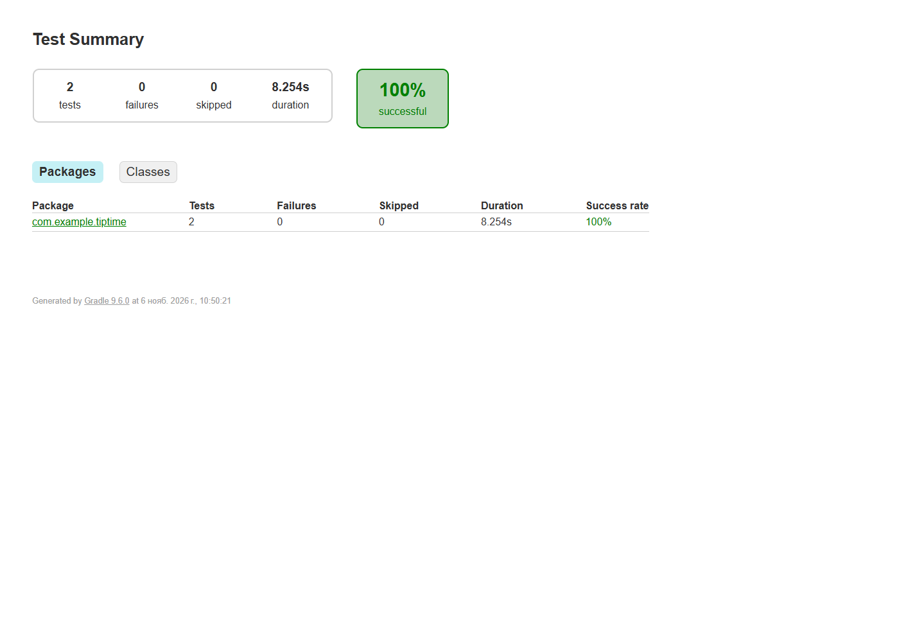
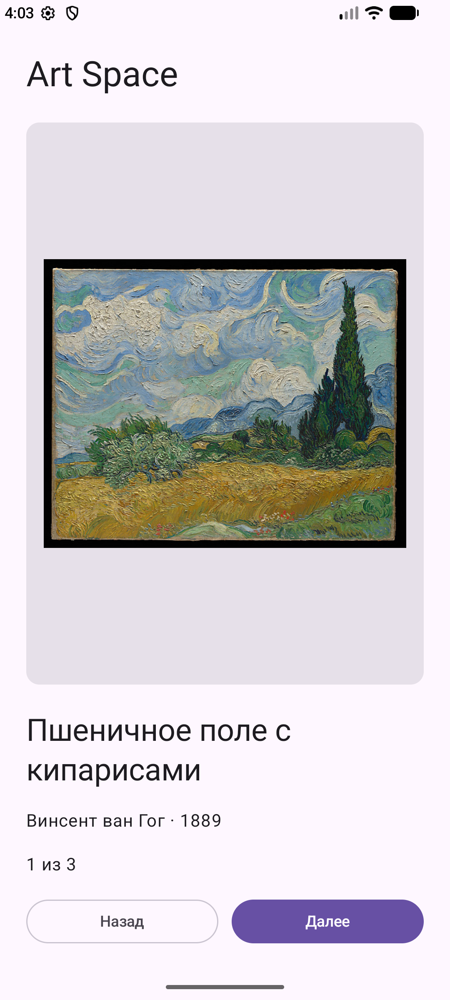
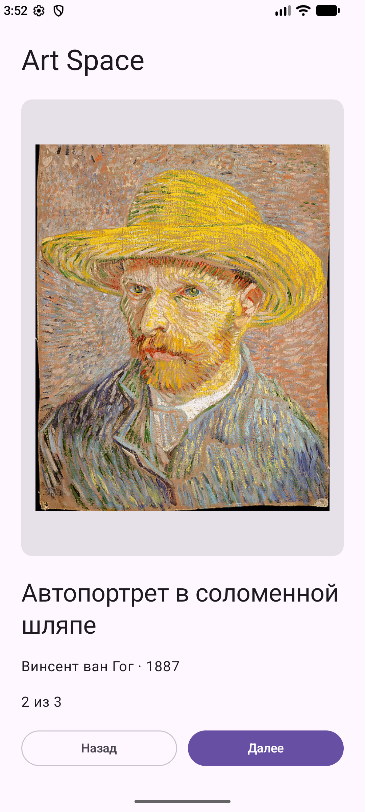
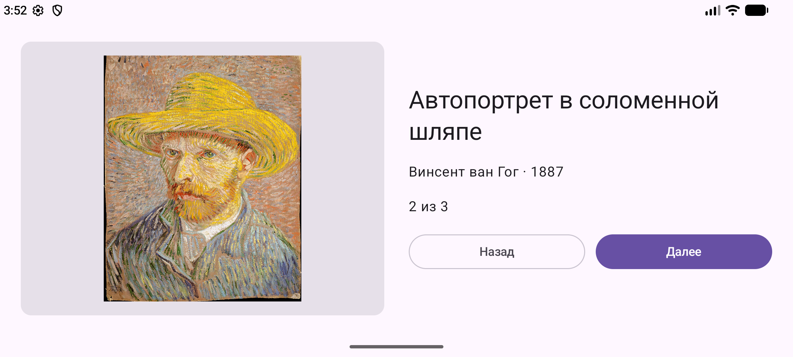

# Лабораторная работа 5

Взаимодействие с интерфейсом Состояние и тестирование

**Выполнил:** Солдатов Владимир Сергеевич  
**Город:** Кемерово  
**Дата:** 6 ноября 2026 года

Отчёт о практической части и контрольных заданиях. Ниже приведены реализация, результаты проверок и настоящие снимки экранов эмулятора.

## Цель и результаты работы

Цель работы — изучить обработку действий пользователя в Jetpack Compose, хранение состояния интерфейса и проверку вычислений модульными и инструментальными тестами.

Выполнены практическое приложение Tip Time и оба контрольных задания: калькулятор с настройкой процента и округлением и галерея ArtSpaceApp. Проекты представлены модулями tiptime и artspace5.

### Состояние и рекомпозиция

Composable-функция описывает интерфейс для текущих данных. Изменение наблюдаемого состояния приводит к рекомпозиции. remember сохраняет значение между рекомпозициями, а rememberSaveable дополнительно восстанавливает поддерживаемые значения при пересоздании Activity. Для полей калькулятора и номера картины используется rememberSaveable.

### Подъём состояния

Текстовые поля получают текущее значение и функцию onValueChange от родительского экрана. Такой подход отделяет отображение поля от хранения данных. Результат вычисляется из суммы, процента и флага округления, поэтому отдельное изменяемое состояние для результата не требуется.

| Модуль | Результат |
| --- | --- |
| tiptime | Два поля ввода, клавиатура Number, действия Next и Done, переключатель округления |
| artspace5 | Три картины из ресурсов, циклическое переключение, when для выбора изображения, альбомный макет |

## Калькулятор чаевых

Сумма чаевых вычисляется по формуле: сумма счёта × процент / 100. При включённом переключателе применяется ceil. Для счёта 11 и процента 20 получается 2,20 руб.; после округления — 3,00 руб.

```kotlin
val tip = amount * tipPercent / 100.0
return if (roundUp) ceil(tip) else tip
```

| Первый экран | Второй экран |
|:---:|:---:|
|  |  |

*Рисунок 1 — Расчёт до округления и после включения переключателя*

## Проверка калькулятора

Модульные тесты проверяют 20 процентов от 10, округление дробного результата, нулевую сумму и некорректный ввод. Инструментальные Compose-тесты вводят значения в настоящие поля интерфейса и проверяют отображение результата и работу переключателя.

| Набор | Количество | Результат |
| --- | --- | --- |
| TipCalculatorTest | 4 | Все тесты прошли |
| TipUITests | 2 | Все тесты прошли на эмуляторе |



*Рисунок 2 — Отчёт выполнения модульных тестов*



*Рисунок 3 — Отчёт инструментальных тестов интерфейса*

## Галерея ArtSpaceApp

Изображения хранятся в drawable. Для каждого произведения заданы название, художник и год. Выбор записи выполняется выражением when. Кнопки «Назад» и «Далее» изменяют номер картины по модулю размера коллекции, поэтому после последней картины отображается первая.

| Первый экран | Второй экран |
|:---:|:---:|
|  |  |

*Рисунок 4 — Начальная картина и переход к следующему произведению*

В галерее представлены три произведения Винсента ван Гога из открытой коллекции Метрополитен-музея: «Пшеничное поле с кипарисами» 1889 года, «Автопортрет в соломенной шляпе» 1887 года и «Олеандры» 1888 года.

## Альбомная ориентация

В портретном режиме изображение располагается над сведениями и кнопками. В альбомном режиме изображение и блок описания размещаются рядом. Переключение композиции определяется размерами окна; выбранный индекс хранится через rememberSaveable.



*Рисунок 5 — Галерея после поворота устройства*

```kotlin
var index by rememberSaveable { mutableIntStateOf(0) }
val art = when (index) {
    0 -> artworks[0]
    1 -> artworks[1]
    else -> artworks[2]
}
```

Проверено переключение картины и последующий поворот. После поворота сохраняется выбранное произведение; интерфейс перестраивается в горизонтальную композицию.

## Выводы и источники

Реализован интерфейс, реагирующий на ввод и нажатия пользователя. Состояние поднято к экрану и сохраняется при изменении конфигурации. Вычисления отделены в чистую функцию и проверены модульными тестами. Инструментальные тесты подтверждают взаимодействие текстовых полей, переключателя и результата. Галерея поддерживает циклическое переключение и две ориентации экрана.

### Источники

Методические указания к лабораторной работе 5, предоставленные в файле Laboratornaja+rabota+5.docx.

Jetpack Compose — состояние: https://developer.android.com/develop/ui/compose/state

Тестирование Compose: https://developer.android.com/develop/ui/compose/testing

The Metropolitan Museum of Art — открытая коллекция, объекты 436535, 436532, 436530: https://www.metmuseum.org/art/collection/search/436535

## Как открыть и запустить

Откройте корневую папку репозитория в Android Studio. После синхронизации выберите один из модулей: `tiptime`, `artspace5`.

Среда исходной проверки: JBR OpenJDK 25.0.3, Gradle 9.6.0, Android Gradle Plugin 9.4.1, Android SDK 37.0, Android Emulator с API 37. Минимальная версия Android — API 24. Локальный путь к SDK создаётся Android Studio в `local.properties` и не хранится в Git.

```powershell
.\gradlew.bat assembleDebug testDebugUnitTest
.\gradlew.bat :tiptime:connectedDebugAndroidTest
```

## Сводка тестов

Модульные тесты: **4**, инструментальные: **2**. Все перечисленные тесты прошли. Результаты: [docs/test-summary.json](docs/test-summary.json).

## Атрибуция

[Источники сведений и изображений](SOURCES.md) · [Учебные проекты и лицензии](THIRD_PARTY_NOTICES.md).
